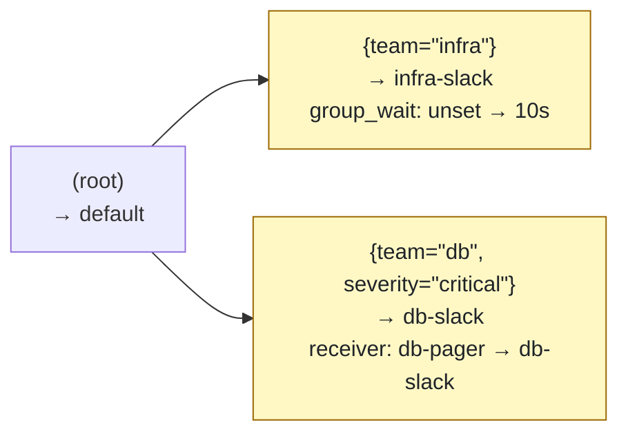

# Usage

amlint finds mistakes in an Alertmanager config before they cost you a missed page. It also
shows where a given alert ends up, runs routing tests in CI, and shows how a change reroutes
alerts.

## In 60 seconds

```bash
amlint check alertmanager.yml                                # find mistakes
amlint route alertmanager.yml team=infra severity=critical   # where does this alert go?
amlint test alertmanager.yml routing-tests.yml               # run your routing tests
amlint diff main.yml alertmanager.yml                        # what does this change break or reroute?
```

| Command | Use it to |
|---------|-----------|
| [`check`](#check) | find mistakes in one or more configs |
| [`tree`](#tree) | print the routing tree with problems marked on it |
| [`route`](#route) | see where an alert with given labels goes |
| [`test`](#test) | run routing unit tests from a file |
| [`diff`](#diff) | compare two configs: new and fixed findings, and alerts that now go elsewhere |
| [`fix`](#fix) | rewrite deprecated syntax (`match:`, `source_match:`, ...) in place |
| [`list`](#list), [`explain`](#explain) | see every check, or read about one |
| [`init`](#init) | print a minimal valid config to start from |
| [`lsp`](#lsp) | show findings in your editor as you type |
| `amlint --version` | print the installed version |

## Find mistakes in a config { #check }

`check` reviews the whole config: routes (the tree of label conditions, called matchers, that
decides where each alert goes), receivers (named notification targets, such as a Slack
channel), inhibit rules (rules that mute some alerts while a related alert fires), timings
and integration settings.

```bash
amlint check alertmanager.yml
amlint check prod.yml staging.yml        # several files
cat alertmanager.yml | amlint check -    # stdin
```

```
  ✖  ERROR  [undefined-receiver]  ·  alertmanager.yml:6:7  ·  route.routes[1]
     Route references receiver 'db-pager' which is not defined in receivers. Alertmanager refuses to load this config.

  ℹ  INFO   [global-resolve-timeout-missing]  ·  alertmanager.yml:1:1  ·  global
     global.resolve_timeout is not set, so Alertmanager uses 5m. It only applies to alerts sent without an end time; Prometheus always sets one.

────────────────────────────────────────
  ✖ 1 error  ·  ℹ 1 info
```

Each finding shows:

- its level: `ERROR`, `WARN` or `INFO`. By default only `ERROR` fails the run.
- the check code. `amlint explain <code>` tells you why it matters and how to fix it.
- `file:line:col`, which most terminals and editors turn into a link.
- the config path: `route.routes[1]` is the second child of the top-level route.

**Options**

| Flag | What it does |
|------|--------------|
| `--strict` | Exit `1` on WARN findings too, not only ERROR |
| `--exit-zero` | Always exit `0` when the config could be read, whatever amlint finds. For report-only CI runs |
| `--ignore CODE` | Skip these checks. Comma-separate the codes or repeat the flag |
| `--only CODE` | Report only these checks. Comma-separate the codes or repeat the flag |
| `--format FORMAT` | `text` (default), `json`, `sarif` ([Code Scanning](#sarif-github-code-scanning)) or `github` ([PR annotations](#github-annotations)) |
| `--rules GLOB` | Also check against your Prometheus alerting rules. Quote the glob; repeat the flag for more ([details](#checking-against-prometheus-rules)) |
| `--input-format FORMAT` | What the file is: `auto` (default, detected), `alertmanager`, `secret`, `helm`, `mimir` or `alertmanagerconfig` ([details](#kubernetes-helm-and-mimir)) |
| `--matcher-strategy STRATEGY` | `alertmanagerConfigMatcherStrategy` for `AlertmanagerConfig` resources: `OnNamespace`, `OnNamespaceExceptForAlertmanagerNamespace` or `None`. Default: the one on the Alertmanager resource in the input, else `OnNamespace` |

**Good to know**

- The line is where that part of the config starts: the `- ` entry of a route, receiver or
  inhibit rule, or a key such as `global:`. If the part is missing (no `global:` block), the
  finding points at the nearest part that exists. JSON and SARIF carry the same line and
  column.
- With several files, text output has one section per file.
- A misspelled code in `--ignore`, `--only` or a [config file](#project-config) prints a
  warning with a "did you mean" suggestion instead of being silently ignored.

### Kubernetes, Helm, Mimir and Grafana

Besides a plain `alertmanager.yml`, amlint reads a Kubernetes Secret or ConfigMap holding
`alertmanager.yaml`, kube-prometheus-stack Helm values, a Mimir or Cortex tenant config,
prometheus-operator `AlertmanagerConfig` resources, which it merges the way the operator
does, and Grafana Alerting's provisioning files and exports. It detects the format; `--input-format` overrides that. Findings point at the line in
the file you passed. `diff`, `tree`, `route` and `test` take `--input-format` and
`--matcher-strategy` too. See [Kubernetes, Grafana & Mimir](kubernetes.md).

### Get JSON output { #json-output }

```bash
amlint check alertmanager.yml --format json
```

The output is a list with one object per finding:

```json
{
  "file": "alertmanager.yml",
  "line": 6,
  "column": 7,
  "level": "error",
  "code": "undefined-receiver",
  "message": "Route references receiver 'db-pager' which is not defined in receivers. Alertmanager refuses to load this config.",
  "where": "route.routes[1]"
}
```

`level` is `error`, `warn` or `info`. `file` is `-` for stdin.

### Set defaults for a repo { #project-config }

amlint reads settings from `.amlint.yml` (or `.amlint.yaml`) in the directory you run it
from. If there is none, it reads `[tool.amlint]` from `pyproject.toml` in that directory.

=== ".amlint.yml"
    ```yaml
    ignore:
      - empty-receiver
      - unused-receiver
    strict: true
    severity:
      empty-receiver: info      # downgrade warn → info
      unused-receiver: error    # upgrade info → error
    rules:
      - rules/*.yml             # Prometheus alerting rules, like --rules
    ```

=== "pyproject.toml"
    ```toml
    [tool.amlint]
    ignore = ["empty-receiver", "unused-receiver"]
    strict = true
    rules = ["rules/*.yml"]

    [tool.amlint.severity]
    empty-receiver = "info"
    unused-receiver = "error"
    ```

| Key | What it does | Used by |
|-----|--------------|---------|
| `ignore` | Checks to skip, added to any `--ignore` codes | `check`, `diff`, `tree`, `lsp` |
| `strict` | Same as `--strict` | `check` |
| `severity` | Sets a check's level to `error`, `warn` or `info` | `check`, `diff`, `tree`, `lsp` |
| `rules` | Globs of [Prometheus rule files](#checking-against-prometheus-rules), relative to the config file's directory. Added to any `--rules` | `check`, `lsp` |
| `tests` | Maps config files to their [`amlint test`](#test) files (a glob or a list of globs), relative to the config file's directory | `test`, `lsp` |

**Good to know:** amlint doesn't look in parent directories or next to the config file. Only
the first file found is read, so `pyproject.toml` is ignored when `.amlint.yml` exists.

### Silence one finding in the config { #inline-suppressions }

Turn a check off for one spot with a comment. The exception and its reason then live next to
the config, not in a global `ignore:` list:

```yaml
# amlint: disable-file=global-resolve-timeout-missing

route:
  receiver: default
  routes:
    - receiver: catch-all   # amlint: disable=unreachable-route
    - matchers: [team="infra"]
      receiver: infra

receivers:
  # amlint: disable=empty-receiver, unused-receiver
  # drops alerts on purpose
  - name: blackhole
```

| Comment | Where | Silences |
|---------|-------|----------|
| `# amlint: disable=code1,code2` | at the end of a line | those codes for findings on that line |
| `# amlint: disable=code1,code2` | on a line of its own | those codes for findings on the next line of YAML (other comment lines in between are fine) |
| `# amlint: disable-file=code1,code2` | in the comment block at the top of the file, before any YAML | those codes for the whole file |

**Good to know**

- A finding's line is the one shown in the output.
- An unknown code gets the same "did you mean" warning as `--ignore`. A `disable-file`
  comment further down the file is ignored, with a warning.
- Suppressions also apply to `diff`, `tree` and the [editor](#lsp), which can add the
  comment for you.

### Check routes against your Prometheus rules { #checking-against-prometheus-rules }

On its own, amlint only sees the Alertmanager config. Give it your alerting rules with
`--rules`, and it also checks that routes and inhibit rules match alerts that actually exist:

```bash
amlint check alertmanager.yml --rules 'rules/*.yml'
amlint check alertmanager.yml --rules 'rules/**/*.yml' --rules 'manifests/*-prometheusrule.yaml'
```

```
  ⚠  WARN   [route-unknown-alertname]  ·  alertmanager.yml:7:7  ·  route.routes[0]
     Route matches alertname 'HighCpuUsage', which no alerting rule in the rule files produces — did you mean 'HighCPUUsage'? Unless such alerts come from another source, this branch is dead.
```

`--rules` adds three checks:

| Code | Level | What it catches |
|------|-------|-----------------|
| [`route-unknown-alertname`](checks/rules.md#route-unknown-alertname) | warn | A route matches an `alertname` no rule produces (typo, renamed or removed rule), with a "did you mean" |
| [`inhibit-unknown-alertname`](checks/rules.md#inhibit-unknown-alertname) | warn | The same for an inhibit rule's source and target matchers |
| [`alert-hits-default-receiver`](checks/rules.md#alert-hits-default-receiver) | info | Based on their static labels, alerts match no child route and go to the root receiver (one finding per `severity=…` etc.) |

**Good to know**

- Put the globs under `rules:` in [`.amlint.yml`](#project-config) to use them on every
  `check` without the flag, and in the [editor](editors.md). `--rules` adds more.
- `--rules` reads Prometheus rule files (`groups:`) and prometheus-operator `PrometheusRule`
  manifests (`spec.groups:`). Recording rules are skipped. `**` matches subdirectories.
- Quote the glob. Unquoted, the shell expands it, and the extra files are either rejected as
  unknown arguments or linted as Alertmanager configs, depending on where `--rules` sits.
  amlint warns when a config looks like a rule file.
- A glob that matches no files, a directory instead of a glob, or a rule file that doesn't
  parse exits `2`. If the files hold no alerting rules, amlint warns and skips the three
  checks.
- amlint only knows `alertname` and the rule's `labels:`. Real alerts also get labels from
  their PromQL series and Prometheus' `external_labels`, so a templated label value counts as
  unknown, and a result that depends on an unknown label is skipped rather than guessed. See
  [Prometheus rules checks](checks/rules.md).

## See the routing tree { #tree }

`tree` prints the route tree with problems marked inline, so you can see how alerts flow
without reading the YAML:

```bash
amlint tree alertmanager.yml
cat alertmanager.yml | amlint tree -   # stdin
```

```
   (root)  →  default
├──    {team="infra"}  →  infra-slack  [continue]
├── ⚠  (catch-all)  →  catch-all  (unreachable-route)
└── ✖  {severity="critical"}  →  pager-team  (undefined-receiver)

  2 routing issues flagged above — run 'amlint check alertmanager.yml' for full details.

  2 more issues outside routing (receivers, global, timing) — run 'amlint check alertmanager.yml' for full details.
```

Each line is one route:

- its matchers, or `(catch-all)` if it has none,
- `→` the receiver it sends to, or `(inherited)` if it doesn't set one,
- `[continue]` when the route has `continue: true`, which tells Alertmanager to keep checking
  the next sibling routes after this one matches,
- the level icon and check codes when a routing check (`undefined-receiver`,
  `unreachable-route`, `route-match-collision`, `bad-regex`, `groupby-ellipsis` and similar)
  fired on that route.

Findings that don't belong to one route (receivers, global settings, timing) are counted
below the tree.

**Options**

| Flag | What it does |
|------|--------------|
| `--ignore CODE` | Don't mark these checks on the tree. Comma-separate the codes or repeat the flag |
| `--format mermaid` | Print a [Mermaid](#tree-mermaid) flowchart instead of the text tree |
| `--input-format`, `--matcher-strategy` | As for [`check`](#check) |

**Good to know:** `tree` exits `0` even when it marks problems. Use `check` to fail CI.

### Draw the tree as a diagram { #tree-mermaid }

`--format mermaid` prints the tree as a [Mermaid](https://mermaid.js.org) flowchart. Put it in
a ` ```mermaid ` block and GitHub, GitLab and MkDocs draw it:

```bash
amlint tree broken.yml --format mermaid
```

```
flowchart LR
    r["(root)<br/>→ default-team<br/>✖ groupby-ellipsis"]
    r_0["(catch-all)<br/>→ catch-all-team<br/>⚠ unreachable-route"]
    r --> r_0
    r_1["{severity=#34;critical#34;}<br/>→ pager-team<br/>✖ undefined-receiver"]
    r --> r_1
    r_2["{service=~#34;auth([#34;}<br/>→ default-team<br/>✖ bad-regex"]
    r --> r_2
    classDef error fill:#ffebe9,stroke:#cf222e,color:#1f2328
    class r,r_1,r_2 error
    classDef warn fill:#fff8c5,stroke:#9a6700,color:#1f2328
    class r_0 warn
```

- Each node shows the matchers, the receiver and `continue`. Routes with an error are red,
  routes with a warning are yellow, and the check codes are on the node.
- Text from the config is written as Mermaid entity codes (`#34;` is a quote), so a receiver
  name can't break the diagram.
- A tree with more than 150 routes stops there, with `…and N more routes`.

## See where an alert goes { #route }

`route` simulates Alertmanager's routing for one alert. It shows which routes the alert
matches, which receivers get it, and the grouping and timings it ends up with: `group_by`
(the labels Alertmanager uses to batch alerts into one notification), `group_wait` (how long
it waits before sending the first notification for a new batch), `group_interval` and
`repeat_interval`.

```bash
amlint route alertmanager.yml team=infra severity=critical alertname=DiskFull
```

```
  Labels  team=infra, severity=critical, alertname=DiskFull

  1. route → route.routes[0] → route.routes[0].routes[0]
    receiver          infra-pager          set here
    group_by          alertname, cluster   inherited from route
    group_wait        10s                  inherited from route.routes[0]
    group_interval    5m                   Alertmanager default
    repeat_interval   1h                   set here

  2. route → route.routes[1]
    receiver          pager                set here
    group_by          alertname, cluster   inherited from route
    group_wait        30s                  Alertmanager default
    group_interval    5m                   Alertmanager default
    repeat_interval   4h                   Alertmanager default

────────────────────────────────────────
  Delivered to: infra-pager, pager
```

Here `route.routes[0]` has `continue: true`. So after the alert reaches its critical child,
`route.routes[1]` is checked too, and matches as well. The last column says where each value
comes from. `mute_time_intervals` and `active_time_intervals` show up when the matched route
sets them.

Pass labels as `label=value`. With no labels, amlint routes an alert that has none. Unlike
`amtool config routes test`, `route` also shows the effective grouping and timings and where
each comes from, and it needs no Go binary.

**How amlint matches**, following Alertmanager:

- Routes are checked depth-first, children in order. A route matches when all its matchers
  match. The first matching child ends the search at its level, unless it has
  `continue: true`. If no child matches, the parent itself is the match.
- `receiver`, `group_by` and the timings are inherited from the parent. Alertmanager's
  defaults are 30s / 5m / 4h. `group_by: []` means no grouping, and `group_by: ['...']`
  groups by every label. Time intervals are not inherited: each route has only its own.
- A label the alert doesn't have matches as the empty string. So `env!="prod"` and `env=""`
  both match an alert without `env`.
- Regexes are fully anchored: `service=~"api"` matches `api`, not `api-gateway`. They follow
  Go RE2, as in Alertmanager: `(?i)` flags, ASCII-only `\d`, `\w`, `\s`, and POSIX classes
  such as `[[:alpha:]]`.
- Matchers are parsed the way Alertmanager parses them, quirks included.
  [Verified against Alertmanager](fidelity.md) shows how this is tested against
  Alertmanager itself.

**Options**

| Flag | What it does |
|------|--------------|
| `--firing 'label=value,...'` | Another alert firing at the same time. Repeat for more alerts. Shows whether an inhibit rule mutes this alert ([details](#inhibition)) |
| `--format json` | JSON output. `text` is the default |
| `--input-format`, `--matcher-strategy` | As for [`check`](#check) |

`--format json` prints `labels`, `receivers`, and for every matched route its `path`, the
effective settings, and `set_by`: the route that set each value. A value missing from
`set_by` is Alertmanager's default. It also has `firing`, `inhibited` and `inhibited_by`
(`rule`, `line`, `column`, and the `source` alert that matched).

**Limits**

- A config Alertmanager would refuse to load exits `2` and names the route at fault: a regex
  RE2 rejects, a malformed duration, matchers on the root route. So does a label that isn't
  `label=value`.
- A regex with Unicode classes such as `\pL` also exits `2`, since amlint can't evaluate it
  the way Go does. Check those routes with `amtool config routes test`.

### Check whether an alert is muted { #inhibition }

`--firing` adds another alert that fires at the same time, as comma-separated `label=value`
pairs. Quote a value that contains a comma: `summary="a, b"`. Repeat the flag for more
alerts. amlint then checks the config's `inhibit_rules` and shows the rule that mutes
(inhibits) the alert, if any:

```bash
amlint route alertmanager.yml alertname=DiskFull instance=db-1 team=infra \
  --firing 'alertname=NodeDown,instance=db-1'
```

```
  Labels  alertname=DiskFull, instance=db-1, team=infra
  Firing  alertname=NodeDown, instance=db-1

  route → route.routes[0]
    receiver          infra-slack          set here
    group_by          alertname, cluster   inherited from route
    group_wait        10s                  set here
    group_interval    5m                   Alertmanager default
    repeat_interval   4h                   Alertmanager default

────────────────────────────────────────
  Inhibited by inhibit_rules[1]  ·  alertmanager.yml:42:5
     while firing: alertname=NodeDown, instance=db-1
  Routed to: infra-slack, but no notification is sent while it is inhibited.
```

The alert is muted when, for some rule:

- the alert matches the rule's `target_matchers`,
- a firing alert matches its `source_matchers`, and
- every label in `equal` has the same value on both alerts. A label missing on both counts
  as equal, since Alertmanager compares missing labels as `""`.

**Good to know**

- An alert never mutes itself, and alerts that match both sides of a rule don't mute each
  other.
- A firing alert still mutes others when it is muted or silenced itself, as in Alertmanager.
- Rules are checked in order. The first one that applies is shown.
- `source_matchers` / `target_matchers` and the older `source_match` / `source_match_re` /
  `target_match` / `target_match_re` both work, with the same anchored RE2 regexes as routes.
- Muting doesn't change routing: the alert lands on the same routes, but Alertmanager sends
  no notification for it.
- An inhibit rule amlint can't evaluate exits `2`, but only when you pass `--firing`.

## Test your routing { #test }

`test` runs unit tests for your routing tree. For each set of alert labels, you state which
receivers the alert must reach. It uses the same simulation as [`route`](#route), against
the local file: no running Alertmanager or Go toolchain needed.

```bash
amlint test alertmanager.yml routing-tests.yml
```

`routing-tests.yml` is a list of cases:

```yaml
- name: critical infra alerts page infra and the on-call
  labels: {team: infra, severity: critical}
  expect: [infra-pager, pager]

- name: warning infra alerts go to slack only
  labels: {team: infra, severity: warning}
  expect: [infra-slack]

- name: unrelated alerts aren't swallowed
  labels: {team: unknown}
  expect: [default]
```

```
  ✓  critical infra alerts page infra and the on-call
  ✓  warning infra alerts go to slack only
  ✓  unrelated alerts aren't swallowed
────────────────────────────────────────
  3 passed
```

Each case has `labels:`, an optional `name:`, and exactly one of these assertions:

| Key | Passes when the alert reaches |
|-----|-------------------------------|
| `expect: [a, b]` | exactly these receivers, in any order |
| `receiver: name` | exactly this one receiver |
| `receivers: [a, b]` | exactly these receivers, in this order (`continue: true` fan-out follows definition order) |
| `drop: true` | no receiver at all |

The cases can also sit under a top-level `tests:` key.

A failing case shows what differs, and which routes the alert matched. Had the second case
said `expect: [infra-slack, pager]`:

```
  ✓  critical infra alerts page infra and the on-call
  ✗  warning infra alerts go to slack only
     labels:    team=infra, severity=warning
     expected:  infra-slack, pager
     actual:    infra-slack
       - pager  expected, not delivered
     routes:    route.routes[0]

────────────────────────────────────────
  1 failed  ·  1 passed
```

`test` exits `1` if any case fails, and `2` if the config can't be simulated (see
[`route`](#route)) or the tests file isn't a list of cases.

Map each config to its tests under `tests:` in [`.amlint.yml`](#project-config), and you
can leave the tests file out. The editor uses the same mapping to show above each route
how many cases reach it:

```yaml
# .amlint.yml
tests:
  alertmanager.yml: routing-tests.yml           # a file, a glob, or a list of them
  k8s/alertmanager-secret.yaml: [tests/k8s/*.yml]
```

```bash
amlint test alertmanager.yml                    # runs routing-tests.yml
```

**Options**

| Flag | What it does |
|------|--------------|
| `--coverage` | List the routes no case reaches, with `file:line:col`, and the coverage percentage ([details](#coverage)) |
| `--fail-under N` | Exit `1` if route coverage is below N% (0 to 100). Turns on `--coverage` |
| `--format json` | JSON output. `text` is the default |
| `--input-format`, `--matcher-strategy` | As for [`check`](#check) |

`--format json` gives one object per case, with `passed`, `expected`, `actual`, `missing`,
`unexpected`, the matched `routes`, and the inhibition fields (`firing`,
`expected_inhibited`, `inhibited`, `inhibited_by`). A malformed case has `error` instead.

### Test inhibition { #inhibition-in-tests }

A case can list `firing:`, the labels of other alerts firing at the same time, and assert
`inhibited: true` or `inhibited: false`. amlint checks it the same way as
[`route --firing`](#inhibition):

```yaml
- name: disk alerts are muted while their node is down
  labels: {alertname: DiskFull, instance: db-1, team: db}
  firing:
    - {alertname: NodeDown, instance: db-1}
  expect: [db-slack]       # where it is routed
  inhibited: true          # ...and that nothing is sent

- name: another node's outage doesn't mute it
  labels: {alertname: DiskFull, instance: db-1, team: db}
  firing:
    - {alertname: NodeDown, instance: db-2}
  expect: [db-slack]       # firing: without inhibited: expects inhibited: false
```

- `inhibited:` goes next to a receiver assertion, which still checks routing, or on its own.
- With `firing:` and no `inhibited:`, the case expects the alert not to be muted.
- A case that fails on inhibition names the rule. Had the second case listed `NodeDown` on
  `db-1`:

```
  ✗  another node's outage doesn't mute it
     labels:    alertname=DiskFull, instance=db-1, team=db
     firing:    alertname=NodeDown, instance=db-1
     expected:  db-slack
     actual:    db-slack
     inhibited: expected no, actual yes
       by inhibit_rules[1]  ·  alertmanager.yml:42:5  ·  while firing: alertname=NodeDown, instance=db-1
     routes:    route.routes[2]
```

### Measure route coverage { #coverage }

`--coverage` lists the routes no case reaches, so you can see what your tests miss:

```bash
amlint test alertmanager.yml routing-tests.yml --coverage
```

```
  ✓  critical infra alerts page infra and the on-call
  ✓  warning infra alerts go to slack only
  ✓  unrelated alerts aren't swallowed
────────────────────────────────────────
  3 passed

  Route coverage  4 of 6 routes  ·  66.7%
  Not matched by any test case:
    route.routes[2]             alertmanager.yml:18:7    {team="db"}  →  db-slack
    route.routes[2].routes[0]   alertmanager.yml:21:11   {severity="critical"}  →  db-pager
```

- A route is covered when a case's alert passes through it: the route it lands on, that
  route's parents, and every branch of a `continue: true` fan-out. The root route counts too.
- Failing cases count. Malformed ones don't, since they aren't routed.
- Some routes can't be covered. Above, `route.routes[2].routes[0]` is unreachable:
  `route.routes[1]` takes every critical alert first. A case for
  `{team: db, severity: critical}` shows it going to `pager`.
- `--fail-under N` exits `1` when coverage is below N%. The percentage is rounded to one
  decimal before the comparison, and is only 100 when every route is covered.

With `--format json` and coverage on, the output is an object instead of a list:

```json
{
  "tests": [ ... ],
  "coverage": {
    "routes": 6, "covered": 4, "percent": 66.7, "fail_under": 90.0,
    "uncovered": [
      {"path": "route.routes[2]", "line": 18, "column": 7},
      {"path": "route.routes[2].routes[0]", "line": 21, "column": 11}
    ]
  }
}
```

## Review a config change { #diff }

`diff` compares two versions of a config, old first. It shows the findings the change fixed
or added, and the alerts it routes differently. Use it on pull requests to catch
regressions.

```bash
amlint diff main.yml alertmanager.yml
```

```
  FIXED  [undefined-receiver]  ·  main.yml:6:7  ·  route.routes[1]
     Route references receiver 'db-pager' which is not defined in receivers. Alertmanager refuses to load this config.

  NEW    [empty-receiver]  ·  alertmanager.yml:15:5  ·  receivers[db-slack]
     Receiver 'db-slack' has no integration configured (no slack_configs, pagerduty_configs, webhook_configs, etc.). Alerts sent here will be silently dropped.

────────────────────────────────────────
  1 fixed  ·  1 new  ·  1 unchanged

──────────────── Routing ────────────────

  team=infra
    infra-slack  group_wait   30s → 10s
    and 1 more label set with the same change

  team=db, severity=critical
    receivers   db-pager → db-slack

  2 routing changes  · 6 label sets checked
```

`diff` exits `1` if the new config has any **new** finding, and `0` otherwise.

**Options**

| Flag | What it does |
|------|--------------|
| `--format FORMAT` | `text` (default), `json`, or `markdown` ([PR comment](#markdown-report)) |
| `--no-routing` | Compare findings only; skip the routing comparison |
| `--ignore CODE` | Skip these checks. Comma-separate the codes or repeat the flag |
| `--only CODE` | Consider only these checks. Comma-separate the codes or repeat the flag |
| `--input-format`, `--matcher-strategy` | As for [`check`](#check) |

`--format json` gives the `added` and `fixed` findings (lines from the new file for `added`,
the old one for `fixed`), the `unchanged` count, and a `routing` object: `checked`,
`truncated` and `changes` (each with `labels`, `differences`, the full `old` / `new` routes
and the number of `similar` label sets), or `skipped` with the reason.

**Good to know**

- A finding counts as unchanged when its code and config path (such as `route.routes[1]`)
  are the same in both files. Moving a route can show its findings as fixed and new.
- An empty old file (`/dev/null`, or a config that is new in a PR) counts as no config at
  all: every finding is new, none is fixed, and every label set's receivers were `(none)`
  before.

### Routing changes { #routing-changes }

After the findings, `diff` sends the same label sets (sample alerts) through both configs,
with the same simulation as [`route`](#route), and lists the ones that come out differently.

- A label set shows up when its receivers change, or when a receiver it reaches gets a
  different `group_by`, `group_wait`, `group_interval`, `repeat_interval` or time intervals.
- Edits that still deliver every alert the same way don't show up: `match:` rewritten as
  `matchers:`, or reordered siblings that never match the same alert.
- Label sets with exactly the same change are folded into one, shown with the smallest label
  set.
- Routing changes don't affect the exit code, since a PR that edits routing usually means
  to.
- If either config can't be simulated (see [`route`](#route)), the section says why, and the
  findings diff still runs.

??? note "How amlint picks the label sets"
    The label sets come from the matchers of both configs: for every label, the values used
    with `=` and `!=`, a few strings each `=~` / `!~` regex fully matches, and the label
    being absent. Small configs get every combination. Larger ones get, for every route, a
    label set that reaches it and one that stops on it, then single-label variations of
    those, spread evenly over the routes and capped at 5000 label sets. The summary says
    when the cap was hit.

### Post the diff as a PR comment { #markdown-report }

`--format markdown` prints a compact report for a pull-request comment:

```bash
amlint diff main.yml alertmanager.yml --format markdown
```

````markdown
### amlint diff

**2 routing changes** · **1 new finding** · 1 fixed · 1 unchanged · 6 label sets checked

#### Receivers

| labels | before | after |
| --- | --- | --- |
| `team=db, severity=critical` | `db-pager` | `db-slack` |

#### Grouping and timings

| labels | receiver | setting | before | after |
| --- | --- | --- | --- | --- |
| `team=infra` (+1 similar) | `infra-slack` | `group_wait` | `30s` | `10s` |

#### Changed routes

Green: added · yellow: changed · red, dashed: removed · grey: unchanged routes, folded.



#### New findings

| level | check | location | message |
| --- | --- | --- | --- |
| ⚠ warning | `empty-receiver` | `alertmanager.yml:15:5` (`receivers[db-slack]`) | Receiver 'db-slack' has no integration configured (no slack\_configs, pagerduty\_configs, webhook\_configs, etc.). Alerts sent here will be silently dropped. |

#### Fixed findings

| level | check | location | message |
| --- | --- | --- | --- |
| ✖ error | `undefined-receiver` | `main.yml:6:7` (`route.routes[1]`) | Route references receiver 'db-pager' which is not defined in receivers. Alertmanager refuses to load this config. |
````

- The summary line always comes first. Each table appears only when it has rows, so an
  unchanged config gives just the heading and the summary.
- `(+1 similar)` means one more label set with exactly the same change.
- **Changed routes** is a Mermaid diagram, which GitHub draws in the comment. It shows the
  routes that were added, removed or changed, with what changed, and the routes above them.
  Unchanged siblings fold into one grey node. Routes are matched by their matchers, so a
  route inserted at the top doesn't make every route below it look changed, but a new
  order of the same routes does: the first match wins. It stops after 40 routes.
- New findings point into the new file, fixed ones into the old file.
- Each table stops after 50 rows with `…and N more`, so a large config can't produce a huge
  comment.
- The output is deterministic. Names from the config are escaped, so a receiver called
  `@team` doesn't ping anyone.
- Exit codes are the same as for text output.

The [GitHub Action](github-action.md#routing-diff-as-a-pr-comment) posts this report as a PR
comment and keeps it up to date.

## Run amlint in CI { #ci-integration }

The [GitHub Action](github-action.md) does all of this for GitHub with a few inputs. To run
the CLI yourself:

### Fail the build on findings

```yaml
# .github/workflows/alertmanager.yml
name: Lint Alertmanager config

on: [push, pull_request]

jobs:
  lint:
    runs-on: ubuntu-latest
    steps:
      - uses: actions/checkout@v7
      - run: pip install amlint
      - run: amlint check alertmanager.yml --strict
```

`--strict` fails the build on WARN findings too. For a report that never fails the build,
use `--exit-zero` instead.

### Exit codes { #exit-codes }

| Command | `0` | `1` | `2` |
|---------|-----|-----|-----|
| `check` | No ERROR findings (WARN and INFO pass unless `--strict`) | An ERROR finding, or a WARN with `--strict` | Input can't be read (see below) |
| `diff` | No new findings | A new finding | Input can't be read |
| `test` | Every case passes and coverage meets `--fail-under` | A case fails, or coverage is below `--fail-under` | Input can't be read, the config can't be simulated, or the tests file isn't a list of cases |
| `route` | The alert was routed, delivered or not | — | Input can't be read, the config can't be simulated, or a label isn't `label=value` |
| `tree` | Always, findings or not | — | No root route, or input can't be read |
| `fix` | Done, or with `--diff`, nothing to change | With `--diff`: something to change | Input can't be read |

"Input can't be read" means: file not found, YAML that doesn't parse, a file that isn't an
Alertmanager config in the format given or detected, or, for `check --rules`, a glob that
matches no files or a rule file that can't be read. `--exit-zero` turns `1` into `0`, but
not `2`.

### Annotate the PR diff { #github-annotations }

`--format github` prints
[workflow commands](https://docs.github.com/en/actions/reference/workflow-commands-for-github-actions)
that GitHub shows as annotations on the PR diff. You don't need SARIF or Code Scanning:

```yaml
- name: Lint Alertmanager config
  run: amlint check alertmanager.yml --strict --format github
```

```
::error file=alertmanager.yml,line=6,col=7,title=amlint undefined-receiver::Route references receiver 'db-pager' which is not defined in receivers. Alertmanager refuses to load this config. (route.routes[1])
::notice file=alertmanager.yml,line=1,col=1,title=amlint global-resolve-timeout-missing::global.resolve_timeout is not set, so Alertmanager uses 5m. It only applies to alerts sent without an end time; Prometheus always sets one. (global)
```

ERROR becomes `::error`, WARN `::warning` and INFO `::notice`. Paths are made relative to
`$GITHUB_WORKSPACE`, so annotations land on the right file even when you pass an absolute
path. Exit codes are the same as for text output.

### Upload to GitHub Code Scanning { #sarif-github-code-scanning }

SARIF output lets GitHub Code Scanning show findings on the PR diff, on the line each finding
points at. The job needs the `security-events: write` permission:

```yaml
- name: Run amlint
  run: amlint check alertmanager.yml --format sarif --exit-zero > results.sarif

- name: Upload to GitHub Code Scanning
  uses: github/codeql-action/upload-sarif@v4
  with:
    sarif_file: results.sarif
```

`--exit-zero` keeps the upload step running when amlint finds errors. Fail the build in a
separate `amlint check` step.

### Catch regressions on a PR { #in-ci-pr-check }

```yaml
- name: Check for regressions
  run: |
    git show origin/main:alertmanager.yml > /tmp/main.yml
    amlint diff /tmp/main.yml alertmanager.yml
```

To get the routing diff as a PR comment, use the GitHub Action's
[`diff-base`](github-action.md#routing-diff-as-a-pr-comment) input.

## Rewrite deprecated syntax { #fix }

`amlint fix` rewrites the syntax Alertmanager has deprecated. `match:` and `match_re:` become
`matchers:`, an inhibition rule's `source_match:` and `target_match:` become
`source_matchers:` and `target_matchers:`, and the top-level `mute_time_intervals:` list
becomes `time_intervals:`.

```bash
amlint fix alertmanager.yml          # rewrite the file
amlint fix --diff alertmanager.yml   # print the changes, write nothing
```

```console
$ amlint fix --diff alertmanager.yml
  ✔ fixed  [deprecated-match]  ·  alertmanager.yml:4:7  ·  route.routes[0].match
  ✔ fixed  [deprecated-match]  ·  alertmanager.yml:9:7  ·  route.routes[1].match
  ✔ fixed  [deprecated-match]  ·  alertmanager.yml:19:5  ·  inhibit_rules[0].source_match
  ✔ fixed  [deprecated-match]  ·  alertmanager.yml:20:5  ·  inhibit_rules[0].target_match
--- alertmanager.yml
+++ alertmanager.yml
@@ -1,12 +1,11 @@
 route:
   receiver: default
   routes:
-    - match:
-        team: db        # the database team
-      match_re:
-        service: pg-.*|mysql
+    - matchers:
+        - team="db"  # the database team
+        - service=~"pg-.*|mysql"
       receiver: db-pager
-    - match: {team: web}
+    - matchers: [team="web"]
       receiver: web
 receivers:
   - name: default
@@ -16,6 +15,6 @@
   - name: web
     webhook_configs: [{url: http://alerts.example.com/web}]
 inhibit_rules:
-  - source_match: {severity: critical}
-    target_match: {severity: warning}
+  - source_matchers: [severity="critical"]
+    target_matchers: [severity="warning"]
     equal: [alertname]
```

**Good to know**

- Before it writes, amlint reads the new config back and checks that every route and
  inhibition rule has the same matchers as before, and that nothing else changed. When it
  can't make such a change, it leaves that spot as it was and prints `✗ left`.
- Only the rewritten keys change. Comments on the `match:` entries move to the new ones.
- `--diff` exits `1` when there is something to change, so CI can require the new syntax.
- It rewrites plain configs and kube-prometheus-stack Helm values. A config inside a Secret,
  a ConfigMap or a Mimir string is checked, but not rewritten.
- `# amlint: disable=deprecated-match` comments and `ignore:` in the
  [project config](#project-config) keep a spot as it is.
- `amlint fix -` reads the config from stdin and prints the fixed config.

The [editor](#lsp) offers the same rewrite as a quick fix.

## See findings in your editor { #lsp }

`amlint lsp` is a language server. Your editor starts it and shows amlint's findings as you
type, on the lines `amlint check` reports. You don't run it yourself.

- **Findings** come from the editor buffer, so you don't have to save first. Each check code
  links to its docs.
- **Hover on a route** shows its matchers, receiver, `group_by` and timings, where each
  value comes from, and an example alert that ends there. It is the same simulation as
  [`route`](#route).
- **Quick fixes** rewrite deprecated syntax the way [`fix`](#fix) does, or add
  `# amlint: disable=<code>` to the line, or `# amlint: disable-file=<code>` to the top of the
  file.
- **Template files** (`.tmpl`) show `bad-template-file`, `undefined-template` and
  `template-unknown-field` on the line where the problem is, for every config in the
  workspace folder whose `templates:` globs load the file. A template file no config loads
  gets its syntax errors only.

It reads every format `check` reads. YAML files without an Alertmanager config, such as
Kubernetes manifests, get no findings.

`ignore` and `severity` come from the [project config](#project-config) in the workspace
folder, or next to the file when it isn't in one. The `--rules` checks don't run in the
editor.

Setup for VS Code, Neovim and Helix: [Editors](editors.md).

## Look up a check

### List all checks { #list }

```bash
amlint list
```

Prints every check code with its level, a one-line description, and a ✓ in the `amtool`
column when `amtool check-config` catches it too. Those are configs Alertmanager refuses to
load. The rest load fine but don't behave as intended. Details for each check are in
[Checks](checks/index.md).

### Explain one check { #explain }

```bash
amlint explain undefined-receiver
amlint explain inhibit-no-equal
```

Shows the check's level, whether amtool catches it, why it matters, and a bad and a fixed
example. Useful when a finding is unfamiliar, or for onboarding. An unknown code exits `2`
and lists the valid ones.

## Start a new config { #init }

`init` prints a minimal valid `alertmanager.yml` to start from:

```bash
amlint init > alertmanager.yml
```
